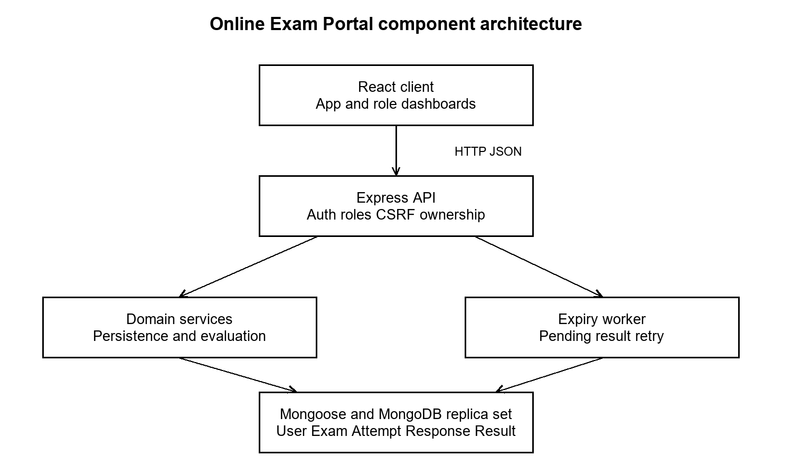

# Release 1 architecture

Final review revision, 5 November 2026. The authoritative [SAD](part-1/Online_Exam_Portal_SAD.docx) contains component responsibilities, traceability, security, two UML sequence diagrams, actual API shapes and error handling.

The application uses a layered client-server MERN architecture: React presentation, Express routes/middleware/controllers, persistence/evaluation services, Mongoose and a MongoDB replica set. A modular application keeps role boundaries and transactional behavior testable without adding microservices.

React App handles login and Instructor management; RoleDashboard supplies Student/Admin dashboards; ExamAttempt handles versioned saves, navigation, countdown and submission; ResultsPanel handles persisted results and loading/pending/error states. Express checks current account status/role, CSRF/origin, ownership and lifecycle. MongoDB transactions and unique indexes protect associations, saves, finalization and one result per attempt.

The independent server worker sweeps expired and evaluation-pending attempts every five seconds by default. Browser closure cannot stop it. Failed evaluation remains Submitted/Pending and retries without reopening answers. MongoDB time is authoritative; the browser's synchronized monotonic timer is a display and edit lock.

Security uses bcrypt hashes, regenerated server sessions, MongoStore, HttpOnly/SameSite cookies, CSRF tokens, exact CORS origin and safe JSON errors. Production requires HTTPS/Secure cookie configuration. Admin does not inherit Student or Instructor operations; Student payloads omit answer keys.

See [software design](07_Software_Design.md), [API contract](AUTH_AND_EXAM_API.md), [Field Layout](OEP-18_Field_Layout.md), [changes from the initial design](FINAL_DEVIATIONS.md) and [executed evidence](FINAL_CHECKPOINT_REPORT.md). No deployment, rate-limit or SonarQube certification is implied.
